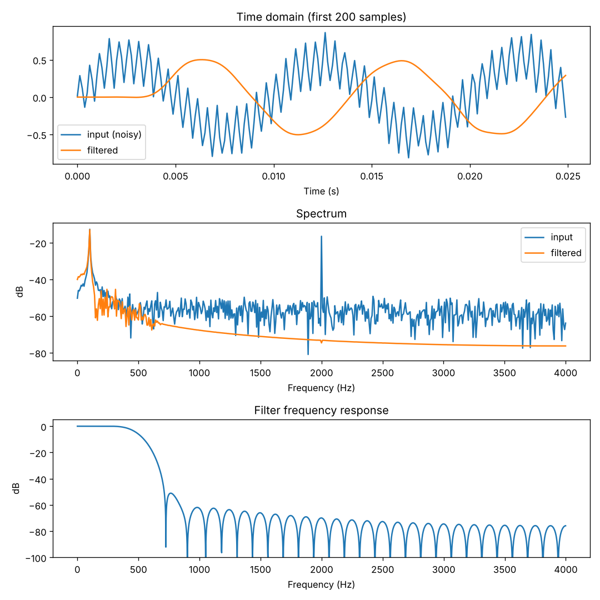

# Fixed-Point FIR Filter and FFT in C

Status: In progress

## Plan
- [x] Python reference: noisy test signal, 63-tap FIR low-pass filter (SciPy)
- [ ] FIR filter in C (floating point), validated against reference
- [ ] Q15 fixed-point FIR filter, with error (SNR) vs reference
- [ ] Radix-2 FFT in C, validated against NumPy
- [ ] Benchmark fixed-point vs floating point

## Reference
`fir_reference.py` generates `input.txt`, `coeffs.txt` and `reference_output.txt`.
The C implementation will be compared against these files.

